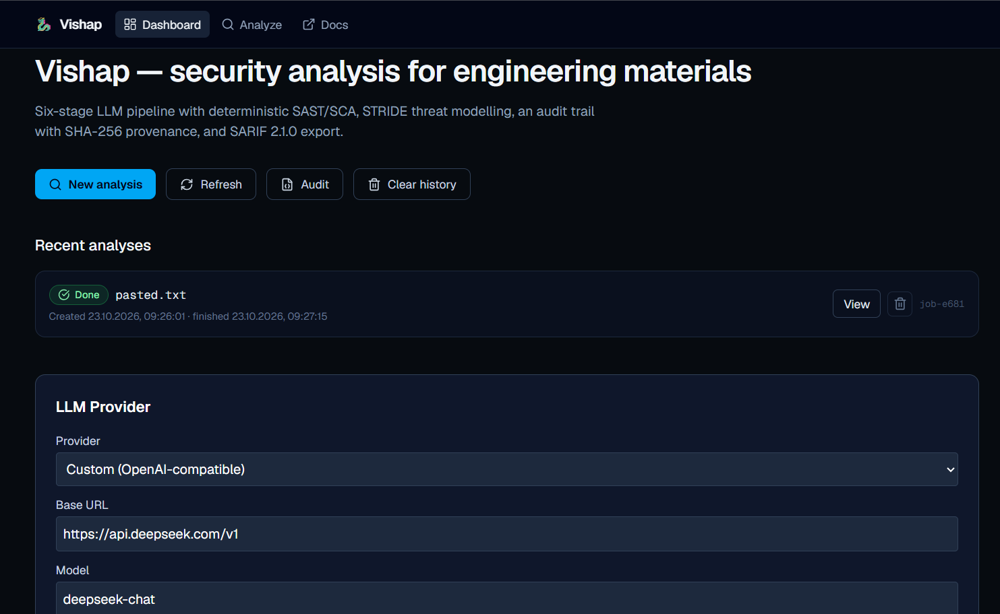

# 🐉 Vishap



[](https://pypi.org/project/vishap-analyzer/)
[](https://github.com/dvddv9/vishap/actions/workflows/ci.yml)
[](https://dvddv9.github.io/vishap/)
[](https://github.com/dvddv9/vishap/releases/tag/v7.3.1)
[](https://www.gnu.org/licenses/agpl-3.0)

> 🐉 **Vishap** — 6-stage LLM pipeline for analyzing engineering materials (code, spec, logs, config, data).

**Vishap** takes a file as input → returns a structured Markdown report with risks, STRIDE threat model, refactoring options and **audit trail** with PII detection and compliance flags.

## 🌐 Live demo

| Service | URL | Stack |
|---------|-----|-------|
| **Frontend** | [vishap-ui.onrender.com](https://vishap-ui.onrender.com) | Next.js 16 · Node 24 |
| **Backend** | [vishap-zwpx.onrender.com](https://vishap-zwpx.onrender.com) | FastAPI · Docker |
| **API docs** | [/docs](https://vishap-zwpx.onrender.com/docs) | Swagger UI |

> ⚠️ Free tier: first request may take 30–50 s (cold start).

## 🎉 What's new in v7.2.6

- **JavaScript / TypeScript support**: `detect_language` (.js/.jsx/.mjs/.cjs/.ts/.tsx), `js_parser.scan_js_patterns` (XSS, SQLi, RCE, path traversal, command injection), LLM hints in `build_prompt`.

### Audit evidence (#1–#8)
- **#1 `context_thread`** — wires metrics / cwe / evidence → activates #3 / #5 / #6
- **#2 `compute_critique_verdict`** — `NEEDS_VERIFICATION` / `REQUIRES_REVIEW` / `SAFE`; critical `risk_nodes` / `security` → `REQUIRES_REVIEW`
- **#3 `fidelity_index`** — 0.0–1.0; bias passed when in `[0.3, 0.95]`
- **#4 `negative_evidence`** — checked-but-not-found CWEs with reason
- **#5 `reproducer`** — runnable `python -c` + verified via `sys.executable`
- **#6 `bias_check`** — critical_ratio, FI-range, RCE-without-critical
- **#7 `CWE_MAPPING`** — 15 keys
- **#8 `report_date` / `valid_until`** — ISO + 90 days

### UI (`ui-next/`)
- **LLMSettings**: provider = `custom` | `harness` (DeepSeek via custom)
- **Report v7.2 block**: Fidelity / Bias check / Reproducer / Negative evidence / Report date / valid_until
- **CORS fix**: `app.add_middleware(CORSMiddleware, ...)` — Settings form works in browser
- **mojibake fix**: em-dash `—`, ellipsis `…`, emoji 🐉

### Backend
- **`async_chat`** — respects `VISHAP_LLM_PROVIDER=custom` (was harness-only)
- **Docker**: bind `0.0.0.0` — `-p 5001:5001` smoke-test passes
- **CI**: ruff F401 cleanup; `ensure_harness` probe fallback; `services.postgres` fix
- **Version sync**: 7.2.2 (`pyproject.toml`, `version.py`, `package.json`, `main.py`, `layout.tsx`)

## 🛠️ Features

- **6-stage pipeline:** Ingestion → Taint Analysis → Dataflow → Risk Assessment → Verdict → Report.
- **Multi-language:** Python, Java, C, **JavaScript / TypeScript** (AST + taint patterns).
- **Multi-provider LLM:** DeepSeek (custom), DSH Harness, or any OpenAI-compatible endpoint (Groq, OpenAI, Mistral, OpenRouter, Together).
- **Async API:** FastAPI + Celery workers (optional in-process fallback).
- **Security:** HMAC-SHA256 for API keys (with pepper), Fernet for secrets.
- **Observability:** Structlog (JSON), Prometheus `/metrics`, OpenTelemetry traces.
- **CI/CD:** GitHub Actions (tests, lint, docs deploy).
- **Desktop:** Tauri app for Windows.

## 📦 Quick Start

### Backend (Docker)
```bash
docker build -t vishap .
docker run --rm -p 5001:5001 \
  -e VISHAP_DEV=true \
  -e VISHAP_LLM_PROVIDER=custom \
  -e CUSTOM_LLM_URL=https://api.deepseek.com/v1 \
  -e CUSTOM_LLM_MODEL=deepseek-chat \
  -e CUSTOM_LLM_KEY=sk-... \
  vishap

## 🧠 Claude Desktop extension

Install **Vishap Security Analysis** in Claude Desktop (Windows/macOS):

1. Download [`claude-plugin/claude-plugin.mcpb`](claude-plugin/claude-plugin.mcpb).
2. Claude → **Settings** → **Extensions** → **Install extension** → select `.mcpb`.
3. **Configure**:
   - `LLM Base URL` — `https://api.deepseek.com/v1` (or OpenAI / Groq / Ollama / any OpenAI-compatible)
   - `LLM API Key` — your key (empty for local Ollama)
   - `LLM Model` — `deepseek-chat` / `gpt-4o-mini` / `llama3.1` / ...
4. **Enable** → ask Claude: *"Analyze this code for SQL injection: ..."*

Source: [`claude-plugin/`](claude-plugin/) · `.mcpb` built with `mcpb pack`.

